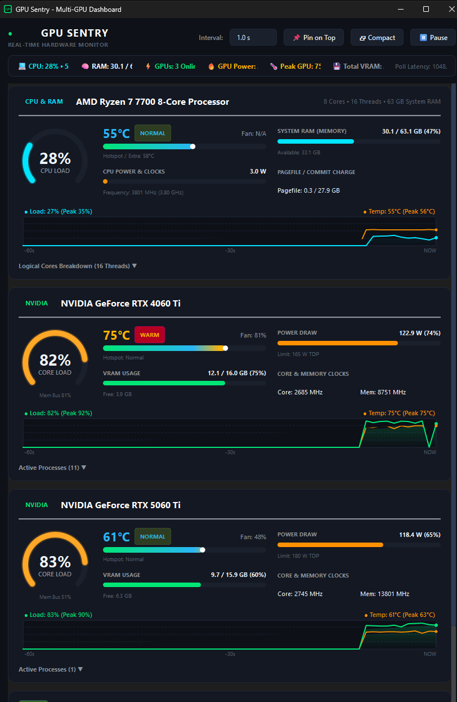

# GPU & System Sentry ⚡

[](https://www.python.org/)
[](LICENSE)
[]()
[](https://github.com/astral-sh/uv)
[](https://github.com/hakanu/gpu_moni/actions/workflows/ci.yml)

A high-performance, lightweight, modern cross-platform (**Windows & Linux**) desktop telemetry and hardware inspection dashboard providing near real-time telemetry for **CPU, System RAM, Local GPUs, Remote Network GPUs, and Deep SMBIOS/Hardware Specifications** in one unified interface.

Built specifically for multi-GPU workstations and LAN clusters (e.g., dual NVIDIA GeForce RTX + AMD Radeon Graphics / APU / Intel Arc + remote Linux/Windows GPU servers) alongside AMD Ryzen / Intel Core processors.



---

## 📑 Table of Contents

- [✨ Key Features](#-key-features)
- [🚀 Quick Start](#-quick-start)
  - [🪟 Windows Setup](#-windows-setup)
  - [🐧 Linux Setup](#-linux-setup)
- [🌐 Network & Tailscale Tailnet GPU Monitoring](#-network--tailscale-tailnet-gpu-monitoring)
- [🧬 Deep Hardware & SMBIOS Specifications](#-deep-hardware--smbios-specifications)
- [⌨️ Command Line Usage & `bpytop` TUI](#️-command-line-usage)
- [💡 Tips & Desktop Integration](#-tips--desktop-integration)
  - [Windows Taskbar Widget](#-windows-taskbar-widget)
  - [Windows Start Menu & Autostart](#-windows-start-menu--autostart)
  - [Linux Wayland & System Tray](#-linux-wayland--system-tray)
- [🏗️ Architecture](#-architecture)
- [🛠️ Development & Packaging](#️-development--packaging)
- [📄 License](#-license)

---

## ✨ Key Features

- **💻 CPU Telemetry & Microarchitecture**:
  - Processor model, vendor, family/stepping, and socket (`Socket AM5`, `LGA1700`, etc.).
  - Core & thread topology (`8 Physical Cores • 16 Logical Threads`), L1/L2/L3 cache hierarchy, and supported ISA extensions (`AVX-512`, `AVX2`, `SSE4.2`, Virtualization).
  - Real-time overall CPU Core Load percentage with radial arc gauge.
  - Live Core Clock frequency (MHz / GHz) alongside Base Clock, Max Boost Clock, and Bus/BCLK frequency.
  - CPU Package Temperature (°C) with dynamic thermal safety status (via ADL on Windows, kernel `hwmon` / `k10temp` / `coretemp` on Linux) and CPU Power consumption in Watts.
  - Expandable **Logical Cores Breakdown**: live bar graph for every thread (`T00` through `T15+`).
- **🧠 System RAM (Memory) Telemetry & Channel Architecture**:
  - Live Used / Total System RAM (e.g., `29.6 / 64.0 GB (46%)`), Available RAM, and Pagefile / Swap usage.
  - Deep SMBIOS Type 16 & Type 17 inspection: **Channel Architecture** (`Dual Channel (2 DPC • 4 DIMMs)`), **Memory Type & Form Factor** (`DDR5 DIMM`), **Active Configured Speed** (`3600 MT/s`) + **Real DRAM Clock** (`1800 MHz`), **JEDEC Base Speed** (`4800 MT/s`), **XMP / EXPO Rated Profile** (`6000 MT/s CL30`), **Operating Voltage** (`1.10 V`), and **Per-Slot Physical DIMM Breakdown Table**.
- **⚡ Multi-GPU Monitoring in One Dashboard**:
  - Automatically discovers and displays all physical GPUs side by side (NVIDIA, AMD, Intel) with architecture (`Ada Lovelace`, `Blackwell`, `RDNA`), CUDA core counts, VBIOS version, and current vs. max PCIe link speed (`Gen 1 x8 / Max Gen 4 x16`).
- **🌐 Tailscale Tailnet & LAN GPU Monitoring (VRAM, Thermals & Wattage)**:
  - **Automatic Tailscale Tailnet GPU Discovery**: Scans `tailscale status --json` and probes online Linux & Windows Tailnet peers over Tailscale SSH / agent ports to automatically discover every machine equipped with an NVIDIA (`nvidia-smi`), AMD (`amdgpu` DRM/`hwmon`), or Intel (`i915`/`xe` DRM/`hwmon`) GPU.
  - **Dedicated Tailnet VRAM, Multi-Sensor Thermals & Wattage Tracking**:
    - **VRAM Usage**: Real-time dedicated VRAM used vs. total GB, utilization percentage, and color-coded memory pressure bar (e.g., `VRAM ■■■■■■ 23.0 / 24.0 GB (96%)`), plus aggregated **Tailnet-wide VRAM usage** in the section header.
    - **Multi-Sensor GPU Thermals**: Displays **Core/Edge (°C)**, **Hotspot/Junction (°C)** (`temp2_input`), **VRAM Memory (°C)** (`temp3_input`), **Fan Speed (RPM & %)**, and dynamic thermal safety badges (`COOL` / `NORMAL` / `WARM` / `HOT` / `THROTTLE`).
    - **Wattage & Power Limits**: Live GPU power draw vs. board TDP limit (`🔥 341.0 / 327W`), plus aggregated **Total Tailnet GPU Wattage** and **Peak Tailnet GPU Temperature** in the header.
  - **Zero-Config LAN Auto-Discovery & LibreHardwareMonitor (`:8085`)**: Automatically finds other PCs/servers running GPU Sentry (`gpu-sentry --agent`) on your subnet (`:51920` / `:51921`) or LibreHardwareMonitor web servers (`:8085`).
- **🖥️ `bpytop`-Inspired Terminal UI (`gpu-sentry-tui`)**:
  - Pure-terminal 24-bit TrueColor ANSI dashboard with Unicode Braille sparklines (`⣀⣄⣤⣦⣶⣷⣿`), rounded box-drawing frames, per-core CPU bars, DDR5 channel/MHz badges, local GPU boxes, Tailscale Tailnet GPU table, and SMBIOS hardware inspector.
  - Ultra-low resource footprint: **`~0.05%` CPU**, **`~38 MB` Private RAM** (no `PyQt6` loaded in TUI mode), and **`~5.4 ms`** local poll latency.
- **🎛️ Motherboard, BIOS, PCIe/M.2 Topology & NVMe/SATA Storage**:
  - Displays motherboard manufacturer, model, revision, serial number, UEFI BIOS version/date, and Secure Boot state.
  - Lists every physical motherboard PCIe & M.2 slot (`PCIEX16_1`, `M.2_1`, etc.) with bus width (`x16`, `x4`, `x1`) and live occupancy status (`In Use` vs `Available`).
  - Queries physical NVMe and SATA drives via native Win32 `IOCTL_STORAGE_QUERY_PROPERTY` (drive model, bus interface, capacity, firmware revision, serial number) + mounted partition usage.
  - Includes a **`📋 Copy Hardware Report`** button to export a complete Markdown specification sheet to your clipboard.
- **🏎️ Ultra-Lightweight & Near Zero CPU Overhead (~0.0% CPU)**:
  - Direct in-process C-level hardware queries using native `nvml.dll` / `libnvidia-ml.so`, `atiadlxx.dll`, DXGI, `GetSystemFirmwareTable` (SMBIOS), `DeviceIoControl`, and Linux DRM sysfs via `ctypes`.
  - Background local queries run in < 1 millisecond on a dedicated asynchronous `QThread`.
- **🌡️ Comprehensive Thermal Telemetry & 60s Rolling Sparklines**:
  - Core, Hotspot, and Memory Temperatures (°C) for CPU and all local/remote GPUs.
  - Dynamic thermal safety badges: `COOL` (<55°C), `NORMAL` (55–70°C), `WARM` (71–80°C), `HOT` (81–88°C), `THROTTLE` (>88°C).
  - Smooth antialiased 60-second rolling sparklines showing both **Core Load (%)** and **Temperature (°C)** simultaneously.
- **📊 Taskbar Widget (Docked near Clock)**:
  - Sleek live telemetry widget docked directly on the Windows taskbar next to the notification tray and clock.
  - **4 Display Layouts**: Compact (2 Rows), Slim (1 Row), Micro Load Bars, and Multi-GPU Strip.
  - **Always-on-Top Z-Order Guard & Virtual Desktop Pinning**: Never drops behind the taskbar during `Win + Left / Right` screen switching and stays pinned across all Windows Virtual Desktops.

---

## 🚀 Quick Start

### 🪟 Windows Setup

#### 1. Direct Install with `uv` (Recommended)
You can install GPU Sentry as a standalone native Windows desktop tool using [uv](https://docs.astral.sh/uv/):
```powershell
# Install directly from GitHub without cloning
uv tool install git+https://github.com/hakanu/gpu_moni.git

# Or install from your local cloned directory
uv tool install . --force

# Launch from anywhere (Command Prompt, PowerShell, Start Menu, or Run dialog)
gpu-sentry
```

> [!TIP]
> **Windows Start Menu**: On first launch, GPU Sentry automatically creates a Windows Start Menu shortcut (`GPU Sentry`) with its custom icon. You can also run `install_shortcut.bat` or `gpu-sentry --install-shortcut` to generate Start Menu and Desktop shortcuts anytime.

#### 2. Instant Launch (`run.bat`)
Double-click `run.bat` in the project root to run without installing:
```bat
run.bat
```

#### 3. Start Menu & Desktop Shortcut Creation
Double-click `install_shortcut.bat` or run:
```powershell
.\.venv\Scripts\python.exe main.py --install-shortcut --desktop
```

#### 4. Run directly with `uv run`
```powershell
uv run gpu-sentry
```

---

### 🐧 Linux Setup

GPU & System Sentry supports all major Linux distributions (Ubuntu, Debian, Fedora, Arch Linux, openSUSE) with Wayland or X11 desktop environments (GNOME, KDE Plasma, XFCE), as well as headless GPU servers via `gpu-sentry --agent`.

#### 1. Install System Dependencies

Make sure Python 3.10+ and standard Qt6 runtime libraries are installed:

- **Ubuntu / Debian / Pop!_OS / Linux Mint**:
  ```bash
  sudo apt update
  sudo apt install -y python3 python3-pip python3-venv libgl1 libegl1 libxkbcommon-x11-0 libxcb-cursor0
  ```

- **Fedora / RHEL / CentOS Stream**:
  ```bash
  sudo dnf install -y python3 python3-pip libglvnd-glx libglvnd-egl libxkbcommon-x11 xcb-util-cursor
  ```

- **Arch Linux / Manjaro / EndeavourOS**:
  ```bash
  sudo pacman -S --needed python python-pip qt6-base
  ```

- **openSUSE Tumbleweed / Leap**:
  ```bash
  sudo zypper install -y python3 python3-pip libglvnd libxkbcommon-x11-0
  ```

#### 2. Install with `uv` (Recommended)

```bash
# Install tool directly via uv
uv tool install git+https://github.com/hakanu/gpu_moni.git

# Launch GUI dashboard
gpu-sentry

# Or run as a headless LAN telemetry agent on a GPU server
gpu-sentry --agent
```

#### 3. Instant Launch with `run.sh`

```bash
chmod +x run.sh
./run.sh
```

---

## 🌐 Network & Tailscale Tailnet GPU Monitoring

Click **`🌐 Network GPUs`** in the top navigation bar (or press `3` / `s` in `gpu-sentry-tui`) to view and manage GPUs across your **Tailscale Tailnet** and **Local Area Network**:

### 1. Automatic Tailscale Tailnet GPU Discovery
- Automatically inspects `tailscale status --json`, identifies online Tailnet peers, and probes each node via `gpu-sentry --agent` (`:51920`), `LibreHardwareMonitor` (`:8085`), or agentless Tailscale SSH (`hakanu@host` / `root@host`).
- Detects **NVIDIA** (`nvidia-smi`), **AMD** (`amdgpu` Linux DRM + `hwmon`), and **Intel** (`i915` / `xe` DRM + `hwmon` / `coretemp`) GPUs across your Tailnet without requiring manual IP configuration.

### 2. Tailnet GPU VRAM, Multi-Sensor Thermals & Wattage
Both the GUI (`Network GPUs` panel & pinned cards) and the TUI (`gpu-sentry-tui`) highlight three core telemetry metrics for every Tailnet GPU:
- **🧠 VRAM Usage & Pressure**:
  - Dedicated VRAM Used vs. Total GB, utilization percentage, and visual memory bar (e.g., `VRAM ■■■■■■ 23.0 / 24.0 GB (96%)` on a remote **AMD Radeon RX 7900 XTX** or **NVIDIA RTX** node).
  - Aggregated **Tailnet Total VRAM** (`Tailnet VRAM: 33.7 / 42.0 GB`) in the section header.
- **🌡️ Multi-Sensor GPU Thermals**:
  - **Edge / Core Temperature (`°C`)** with color-coded safety badge (`COOL`, `NORMAL`, `WARM`, `HOT`, `THROTTLE`).
  - **Hotspot / Junction Temperature (`Junc: 84°C`)** (`temp2_input` on AMD RDNA / NVIDIA Hotspot).
  - **VRAM Memory Temperature (`Mem: 80°C`)** (`temp3_input` on GDDR6/GDDR6X).
  - **Fan Speed (`🌀 1613 RPM` / `%`)** and **Peak Tailnet GPU Temperature** summary in the header.
- **🔥 Wattage & Power Limits**:
  - Real-time GPU board power draw in Watts alongside the configured TDP power limit (`🔥 341.0 / 327 W`).
  - Aggregated **Total Tailnet GPU Wattage** (`🔥 371.1 W`) across all active Tailnet GPUs.

### 3. LAN Auto-Discovery, Agentless SSH & LibreHardwareMonitor
1. **Automatic LAN Discovery (`GPU Sentry` / `gpu-sentry --agent`)**:
   - Every machine running GPU Sentry serves live JSON telemetry on TCP port `51920` (`/api/telemetry`) and responds to UDP LAN discovery broadcasts on port `51921`.
   - For headless Linux/Windows servers without a monitor, run:
     ```bash
     gpu-sentry --agent
     # Or specify a custom port:
     gpu-sentry --agent --port 51920
     ```
2. **Agentless SSH Monitoring (`SSH (nvidia-smi / amdgpu / drm)`)**:
   - Select **`SSH Agentless`** in the Network GPUs card, enter `user@hostname` (or a Tailscale MagicDNS name), and click **`➕ Connect Node`**.
3. **LibreHardwareMonitor / OpenHardwareMonitor Web Server (`:8085`)**:
   - Select **`LibreHardwareMonitor (:8085)`** and enter `host:8085` to poll remote Windows PCs running LibreHardwareMonitor's HTTP server.
4. **Full Dashboard Cards**:
   - Toggle **`📌 Show as Full GPU Cards`** to display remote Tailnet/LAN GPUs directly in the main GUI dashboard with 60-second rolling temperature & utilization sparklines and radial arc gauges.

---

## 🧬 Deep Hardware & SMBIOS Specifications

Click **`🧬 Hardware Specs`** in the top navigation bar (or press `4` / `h` in `gpu-sentry-tui`) to inspect low-level machine specifications:

- **🧠 Memory & Channels**: Total installed & max board capacity, Dual/Quad-Channel mode (`2 DPC • 4 DIMMs`), active configured MT/s & real DRAM clock (MHz), JEDEC base clock, XMP/EXPO rated profile decoded from module part numbers, voltage, and a **Per-Slot Physical DIMM Table**.
- **🎛️ Motherboard, BIOS & Slots**: Board manufacturer, model, revision, serial number, BIOS vendor/version/date, UEFI & Secure Boot state, and SMBIOS Type 9 PCIe & M.2 slot map (`In Use` vs `Available`).
- **💻 Processor (CPU)**: Full model name, stepping identifier, socket, Base / Boost / BCLK clocks, core VID, L1/L2/L3 cache sizes, virtualization status, and ISA feature flags.
- **⚡ GPU Deep Specs**: Architecture codename, CUDA core counts, dedicated VRAM, TDP power limits, current vs. max PCIe generation/width, max boost clocks, driver version, VBIOS version, and hardware UUID.
- **💽 NVMe / SATA Storage & OS**: Physical disk models, NVMe/SATA bus interface, capacity, firmware revision, serial numbers, partition usage, OS build, and kernel uptime.
- **📋 Copy Hardware Report**: Copies a formatted Markdown report of all system specifications to your clipboard in one click.

---

## ⌨️ Command Line Usage

| Command | Description |
|---|---|
| `gpu-sentry` | Launches the full GUI dashboard, Tailnet/LAN monitor, and taskbar widget |
| `gpu-sentry-tui` / `gpu-sentry-cli --tui` | Launches the **`bpytop`-inspired Terminal UI (TUI)** directly in your terminal |
| `run_tui.bat` | Launches the `bpytop`-inspired TUI on Windows in one click |
| `gpu-sentry --minimized` | Starts silently in background (Taskbar widget & system tray only) |
| `gpu-sentry --agent` | Runs as a headless LAN telemetry agent (`HTTP :51920` + `UDP :51921`) |
| `gpu-sentry --agent --port 51925` | Runs headless LAN telemetry agent on a custom TCP port |
| `gpu-sentry --install-shortcut` | Creates Windows Start Menu shortcut (`GPU Sentry`) or Linux `.desktop` entry |
| `gpu-sentry --install-shortcut --desktop` | Creates both Start Menu / App Launcher and Desktop shortcuts |
| `gpu-sentry --remove-shortcut` | Removes desktop & Start Menu shortcuts |
| `gpu-sentry --autostart` | Enables launching automatically on Windows/Linux system login |
| `gpu-sentry --no-autostart` | Disables system login autostart |

### 🖥️ `bpytop`-Inspired Terminal UI (TUI)

Prefer a pure terminal monitor over SSH, tmux, or Windows Terminal? Run:
```powershell
gpu-sentry-tui
# or:
python main.py --tui
```

```text
╭─ 🌐 Tailnet & LAN GPUs ─ 6/6 Online ─ 6 GPUs ─ Tailnet VRAM: 33.7/42.0GB • 🔥 371.1W • 🌡 Peak 59°C ──────────────╮
│● hakuxtx   AMD Radeon RX 7900 XTX    Load █████ 100% │ VRAM ██████ 23.0/24.0GB(96%) │ 59°C[NORM] Junc:84°C Mem:80°C 🌀1613RPM │ 🔥341.0/327W │
│● gmk       AMD Radeon HawkPoint1     Load ░░░░░   0% │ VRAM ████░░ 10.7/16.0GB(67%) │ 35°C[COOL]                            │ 🔥  4.1W     │
│● mininas   AMD Radeon Barcelo        Load ░░░░░   0% │ VRAM ░░░░░░  0.0/ 2.0GB( 2%) │ 40°C[COOL]                            │ 🔥 26.0W     │
│● leno      Intel UHD Graphics 630    Load ░░░░░   0% │ VRAM ░░░░░░     Shared iGPU  │ 43°C[COOL]                            │ 🔥  --W      │
│● anneleno  Intel UHD Graphics 630    Load ░░░░░   0% │ VRAM ░░░░░░     Shared iGPU  │ 40°C[COOL]                            │ 🔥  --W      │
│● nashaku   Intel Xeon E3-1200 v3 GPU Load ░░░░░   0% │ VRAM ░░░░░░     Shared iGPU  │ 59°C[NORM]                            │ 🔥  --W      │
╰──────────────────────────────────────────────────────────────────────────────────────────────────────────────────╯
```

- **24-bit TrueColor ANSI Gradients & Unicode Braille Sparklines** (`⣀⣄⣤⣦⣶⣷⣿`).
- **Interactive Hotkeys**:
  - `1`: Show/Hide CPU, Per-Core Grid & System RAM (with DDR5 Channel/MHz badges)
  - `2`: Show/Hide Local GPUs
  - `3`: Show/Hide Tailscale Tailnet & LAN GPUs
  - `4` / `h`: Toggle bottom panel between **Active GPU Processes** and **Deep SMBIOS Hardware Specifications**
  - `s` / `t`: Force immediate Tailscale Tailnet & LAN GPU scan
  - `+` / `-`: Increase / decrease refresh rate (`250ms` – `3000ms`)
  - `p` / `Space`: Pause / Resume telemetry
  - `q` / `Esc`: Quit cleanly
- **Ultra-Low TUI Resource Footprint** (bypasses `PyQt6` completely in `--tui` mode):

| Metric | Measured Value |
|---|---|
| **Average CPU Usage** (`1000 ms` refresh) | **`0.05%`** across logical cores |
| **Private Memory (RAM)** | **`~38.0 MB`** (`~52.2 MB` Working Set / RSS) |
| **Local Poll + Frame Render Latency** | **`~5.4 ms`** per tick (`NVML` + `SMBIOS` + `ANSI` render) |

---

## 💡 Tips & Desktop Integration

### 🪟 Windows Taskbar Widget
- **Dock Next to Clock**: Right-click the taskbar widget and select **`📌 Dock Next to Clock`** to automatically re-center the widget directly adjacent to the Windows notification tray.
- **Drag & Reposition**: Click and drag the widget anywhere on the taskbar or desktop. Right-click and choose **`🔒 Lock Position`** to freeze it in place.
- **Screen & Multi-Monitor Switching (`Win + Left / Right`)**:
  - Stays on top of both primary (`Shell_TrayWnd`) and secondary (`Shell_SecondaryTrayWnd`) taskbars even during Aero Snap (`Win + Left / Right`), Snap Assist, or multi-monitor window movement.
  - Uses `WS_EX_NOACTIVATE` and focus rejection so pressing `Win + Left / Right` always snaps your active application window and never hijacks the widget.
- **Virtual Desktops (`Win + Ctrl + Left / Right`)**:
  - Automatically registered with Windows Virtual Desktop Manager (`IVirtualDesktopPinnedApps`), keeping the widget visible across all virtual desktops.

### 🪟 Windows Start Menu & Autostart
- **Start Menu**: Integrates with Windows via native `IShellLinkW` COM and appears in the Windows Start Menu and Windows Search with its custom icon.
- **Start on Windows Boot**: Right-click the tray icon or taskbar widget and toggle **`🚀 Start on Windows Boot`**.

### 🐧 Linux Wayland & System Tray
- **GNOME Shell System Tray**: On GNOME, install the [AppIndicator and KStatusNotifierItem Support](https://extensions.gnome.org/extension/615/appindicator-support/) GNOME extension so system tray icons appear in the top bar.
- **KDE Plasma & XFCE**: System tray icons and floating tool windows work natively out of the box.

---

## 🏗️ Architecture

```
gpu_moni/
├── assets/
│   ├── gpu_sentry.ico             # High-res Windows application & shortcut icon
│   ├── gpu_sentry.png             # High-res Linux desktop entry icon
│   └── screenshot.png             # Dashboard preview
├── core/
│   ├── gpu_types.py               # Data classes (HostMetrics, CpuMetrics, RamMetrics, GpuDevice, GpuMetrics)
│   ├── hardware_info.py           # Native SMBIOS 3.6 parser, CPUID/ISA detector & Win32 Storage IOCTL inspector
│   ├── network_telemetry.py       # LAN HTTP/UDP telemetry server, auto-discovery, SSH & LibreHardwareMonitor client
│   ├── host_backend.py            # Cross-platform CPU & RAM telemetry (hwmon, psutil, ADL)
│   ├── nvml_backend.py            # Direct C ctypes wrapper for NVIDIA nvml.dll / libnvidia-ml.so
│   ├── adl_backend.py             # Direct C ctypes wrapper for AMD atiadlxx.dll / ADL2 PMLog
│   ├── dxgi_backend.py            # DXGI adapter enumerator & PDH memory counters (Windows)
│   ├── monitor_worker.py          # Asynchronous QThread background telemetry engine (Windows & Linux)
│   └── shortcut.py                # Native COM Start Menu shortcut & login autostart manager
├── ui/
│   ├── theme.py                   # Dark cyberpunk / Fluent modern QSS & palette
│   ├── widgets/
│   │   ├── taskbar_widget.py      # Floating/dockable taskbar telemetry widget next to clock
│   │   ├── cpu_ram_card.py        # Dedicated CPU & RAM card with per-thread breakdown & SMBIOS badges
│   │   ├── gpu_card.py            # Responsive individual GPU telemetry card (local & remote)
│   │   ├── network_nodes_card.py  # LAN & remote GPU thermal monitor & node manager
│   │   ├── hardware_specs_card.py # Deep hardware specifications viewer & Markdown report exporter
│   │   ├── arc_gauge.py           # Antialiased radial circular gauge for load %
│   │   ├── sparkline.py           # 60-second real-time dual-metric rolling sparkline chart
│   │   └── thermal_bar.py         # Gradient thermal bar & status badge
│   └── main_window.py             # Main window with summary ribbon, controls, system tray
├── .github/
│   └── workflows/
│       └── ci.yml                 # Multi-OS automated build & validation workflow
├── pyproject.toml                 # Modern PEP 621 packaging for uv tool install & pip
├── main.py                        # Desktop application & headless agent entry point
├── run.bat                        # Instant Windows launcher (silent pythonw)
├── install_shortcut.bat           # 1-click Start Menu & Desktop shortcut installer
├── run.sh                         # Instant Linux launcher
└── requirements.txt               # Minimal dependencies (PyQt6, psutil)
```

---

## 🛠️ Development & Packaging

Building and developing with [uv](https://docs.astral.sh/uv/):

```bash
# Clone the repository
git clone https://github.com/hakanu/gpu_moni.git
cd gpu_moni

# Create environment and install in editable mode
uv pip install -e .

# Run application
uv run gpu-sentry

# Build source distribution and wheel
uv build
```

---

## 📄 License

This project is licensed under the MIT License - see the [LICENSE](LICENSE) file for details.
