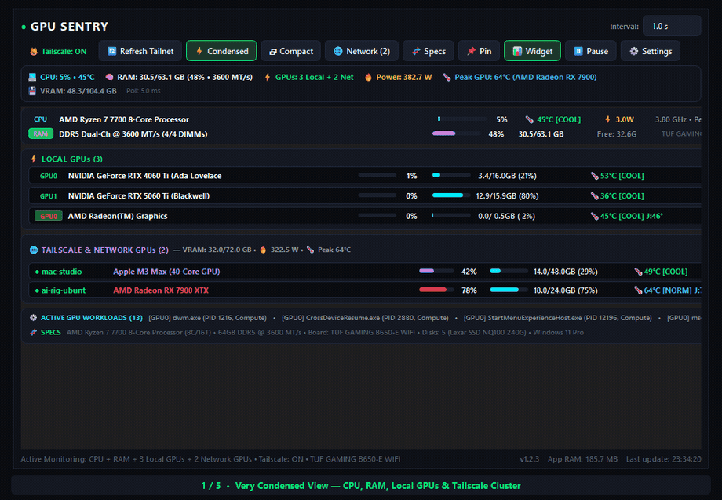

# GPU & System Sentry ⚡

[](https://hakanu.github.io/gpu_moni/)
[](https://github.com/hakanu/gpu_moni/releases/latest)
[](https://www.python.org/)
[-brightgreen.svg)]()
[](https://github.com/hakanu/gpu_moni/actions/workflows/ci.yml)
[](LICENSE)

A lightweight, real-time **multi-GPU, CPU, RAM, hardware specs & Tailscale/LAN telemetry** dashboard for **Windows & Linux** — available as a desktop GUI, a floating Windows taskbar widget, and a `bpytop`-inspired terminal UI (`gpu-sentry-tui`).



---

## 🚀 Quick Install

### 🪟 Windows (Recommended — Standalone GUI `.exe`, No Python, Auto-Updates)

Download **`gpu-sentry-windows-x64.exe`** from **[GitHub Releases](https://github.com/hakanu/gpu_moni/releases/latest)**, or run this one-liner in PowerShell:

```powershell
$dir = "$env:LOCALAPPDATA\GPUSentry"; New-Item -ItemType Directory -Force -Path $dir | Out-Null
Invoke-WebRequest -Uri "https://github.com/hakanu/gpu_moni/releases/latest/download/gpu-sentry-windows-x64.exe" -OutFile "$dir\gpu-sentry.exe" -UseBasicParsing
Start-Process "$dir\gpu-sentry.exe" -ArgumentList "--install-shortcut" -Wait
Start-Process "$dir\gpu-sentry.exe"
```

- Zero console window (`WINDOWS_GUI` binary)
- Auto-checks & installs new GitHub Releases with `SHA256SUMS.txt` verification (**⚙ Settings → Updates**)

### 🐧 Ubuntu / Linux (or Windows via `uv`)

```bash
# Install uv if needed: curl -LsSf https://astral.sh/uv/install.sh | sh
uv tool install --force git+https://github.com/hakanu/gpu_moni.git
```

Update anytime with `gpu-sentry --update` (automatically pulls the latest GitHub Release wheel) or `uv tool upgrade gpu-sentry`.

---

## ✨ What It Does

| Area | Highlights |
| :--- | :--- |
| **Multi-GPU Telemetry** | Native **NVIDIA** (NVML), **AMD** (Windows ADL + zero-dependency Linux `amdgpu` DRM/`hwmon`), **Intel** (`i915`/`xe`), and remote **Apple Silicon** (Metal `ioreg`). Tracks Load, VRAM/GTT, Core/Hotspot/Memory temps, Power vs TDP, Fan RPM/%, Clocks, and **Session Peaks**. |
| **Smart GPU Workloads** | Identifies **what is keeping local & remote Tailscale GPUs busy** — extracts models & scripts (`🦙 Ollama (qwen3:32b)`, `⚡ vLLM`, `🦙 llama.cpp`, `🎨 ComfyUI`, `🔥 AI Training`, `🎬 FFmpeg`, `🎮 Games`) across Windows (NVML + PDH), Linux (NVIDIA + `amdgpu` `fdinfo`), and macOS, with 1-click **Kill Process** for local stuck jobs. |
| **Alerts, Energy & Logs** | Configurable desktop alerts for **High GPU Temp**, **VRAM Pressure**, and **Remote Node Offline** (with cooldowns), optional **local GPU Energy Burn tracking** (Today / 7-Day / 30-Day **kWh** + estimated cost in `~/.gpu_sentry_energy.json`), and optional **local-only CSV / JSONL** hardware logs (`~/GPU_Sentry_Logs`). |
| **CPU, RAM & Deep Specs** | CPU load, per-thread bars, clocks, package temp/wattage, RAM usage + SMBIOS DIMM breakdown (DDR5/DDR4 channels, MT/s, real MHz, XMP/EXPO, voltage), Motherboard/BIOS, PCIe/M.2 slots, and NVMe/SATA drives. |
| **Flexible Views** | **⚡ Condensed View** (default — everything in one glance), **Full Cards View** (radial gauges + 60s sparklines), **Compact Mode**, **Windows Taskbar Widget** (docks next to the clock), and **24-bit TrueColor TUI** (`gpu-sentry-tui`, auto-fallback over SSH). |
| **Responsive UI & Settings** | Wrapping toolbars & buttons (`FlowLayout` + `WrapButton`), saved window geometry, **UI Scale (`85%`–`150%`)**, **°C / °F** toggle, autostart, close-to-tray, and **GitHub Releases auto-updater** in **⚙ Settings**. |
| **Tailscale & LAN GPUs** | Opt-in remote GPU monitoring across your **Tailscale Tailnet** (Linux, macOS, Windows) and **LAN** (`:51920` / LibreHardwareMonitor `:8085`). Click **`🦊 Tailscale: OFF`** or **`🔄 Refresh Tailnet`** whenever you want to scan. |

---

## 🌐 Tailscale & LAN Multi-Machine Setup

Tailscale scanning is **OFF by default on fresh installs** so the app never surprises you with background SSH probes. To monitor remote GPUs:

1. Click **`🦊 Tailscale: OFF`** or **`🔄 Refresh Tailnet`** in the top bar, Condensed view, or System Tray (or press `t` / `r` in `gpu-sentry-tui`).
2. Remote machines are discovered automatically via:
   - **Linux & macOS (Agentless SSH)**: Requires passwordless SSH (`BatchMode=yes`). On macOS (e.g. Mac mini), enable **System Settings → General → Sharing → Remote Login** and copy your SSH key once:
     ```powershell
     type $env:USERPROFILE\.ssh\id_ed25519.pub | ssh <mac_user>@<mac_host> "mkdir -p ~/.ssh && chmod 700 ~/.ssh && cat >> ~/.ssh/authorized_keys && chmod 600 ~/.ssh/authorized_keys"
     ```
   - **Any OS (Headless Agent, No SSH needed)**: Run `gpu-sentry --agent` on the remote machine (listens on HTTP `:51920` + UDP `:51921`).
   - **Windows (LibreHardwareMonitor)**: Automatically detects LHM web server on `:8085`.

---

## ⌨️ CLI Commands

| Command / Flag | Description |
| :--- | :--- |
| `gpu-sentry` | Launch GUI (falls back to TUI automatically on headless Linux/SSH) |
| `gpu-sentry-tui` / `gpu-sentry --tui` | Launch `bpytop`-style Terminal UI (`~38 MB` RAM, no PyQt6 loaded) |
| `gpu-sentry --once` | Print a single TUI snapshot to stdout and exit |
| `gpu-sentry --condensed` / `--expanded` | Force Very Condensed View or Full Cards View |
| `gpu-sentry --tailscale` / `--no-tailscale` | Start with Tailscale GPU discovery ON or OFF |
| `gpu-sentry --agent [--port 51920]` | Run as a headless LAN/Tailnet telemetry server |
| `gpu-sentry --minimized` | Start minimized to system tray & taskbar widget |
| `gpu-sentry --update` | Self-update from GitHub Releases / `uv` |
| `gpu-sentry --install-shortcut [--desktop]` | Install Start Menu (or Linux `.desktop`) shortcut |
| `gpu-sentry --autostart` / `--no-autostart` | Enable or disable launch on system login |

---

## ⚠️ Windows, Tailscale & SSH Quirks

<details>
<summary><b>Why did small terminal windows flash on Windows during Tailscale scan?</b></summary>

Windows OpenSSH (`C:\Windows\System32\OpenSSH\ssh.exe`) has a known quirk: when a GUI (`--windowed` / `pythonw.exe`) app spawns `ssh.exe` with `CREATE_NO_WINDOW`, OpenSSH sees no attached console and calls `AllocConsole()`, briefly flashing a black terminal window for each peer.

**How GPU Sentry prevents this**:
1. Tailscale scanning is **OFF by default** on fresh installations (opt-in via **`🔄 Refresh Tailnet`**).
2. SSH probes pass `-T -n`, `SSH_ASKPASS_REQUIRE=never`, and `STARTUPINFO(STARTF_USESHOWWINDOW, SW_HIDE)` *without* `CREATE_NO_WINDOW`, giving `ssh.exe` a hidden console handle so no window flashes.
</details>

<details>
<summary><b>Why isn't my Mac mini / Linux Tailnet machine showing up?</b></summary>

- Click **`🔄 Refresh Tailnet`** to clear cached probe states and re-scan.
- Agentless SSH uses `BatchMode=yes` (non-interactive). If you see `Permission denied (publickey,password,keyboard-interactive)`, copy your SSH public key to `~/.ssh/authorized_keys` on the remote machine, or run `gpu-sentry --agent` on it.
- Note: The macOS App Store edition of Tailscale does not support running a Tailscale SSH server — use macOS **Remote Login** + SSH keys, or `gpu-sentry --agent`.
- If the remote username differs from your local username or `root`, add `<user>@<host>` once in the **Network GPUs** panel.
</details>

<details>
<summary><b>Windows `uv tool` console shim, file locks & virtual desktops</b></summary>

- **No background terminal**: The standalone Windows `.exe` from GitHub Releases is a `WINDOWS_GUI` binary. For `uv tool` installs, `gpu-sentry` is a console shim so `gpu-sentry --tui` works in PowerShell; Windows shortcuts & autostart automatically use `pythonw.exe` (and GUI launches detach any auto-spawned console via `FreeConsole()`).
- **Virtual Desktops**: The main dashboard stays strictly on the virtual desktop where you open it (any legacy app-wide virtual desktop pin is automatically cleared on startup).
- **Updating on Windows**: The standalone `.exe` self-updates cleanly in place. If using `uv tool` on Windows while the app is running, exit from the tray or run `taskkill /F /IM gpu-sentry.exe 2>$null` before upgrading.
</details>

---

## 🔒 Privacy & Zero Tracking

GPU Sentry has **zero analytics, zero user tracking, and zero phone-home**. All hardware metrics and optional CSV/JSONL logs stay strictly on your machine. The only network activity the app ever performs is:

- **GitHub Releases update check** (`api.github.com/repos/hakanu/gpu_moni/releases/latest`, read-only — can be disabled in **⚙ Settings → Updates**).
- **Localhost Ollama lookup** (`127.0.0.1:11434/api/ps` — loopback only, never leaves your machine).
- **Your own LAN / Tailnet machines** (opt-in — Tailscale scanning is OFF by default on fresh installs).

---

## 🛠️ Development

```bash
git clone https://github.com/hakanu/gpu_moni.git
cd gpu_moni
uv run python main.py          # Run GUI
uv run python main.py --tui    # Run TUI
uv build                       # Build wheel & sdist
```

Pushing a `v*` tag triggers [`.github/workflows/release.yml`](.github/workflows/release.yml), which builds and publishes `gpu-sentry-windows-x64.exe`/`.zip`, `gpu-sentry-linux-x64`/`.tar.gz`, Python `.whl`/`.tar.gz`, and `SHA256SUMS.txt` to GitHub Releases.

---

## 📄 License

MIT — see [LICENSE](LICENSE).
